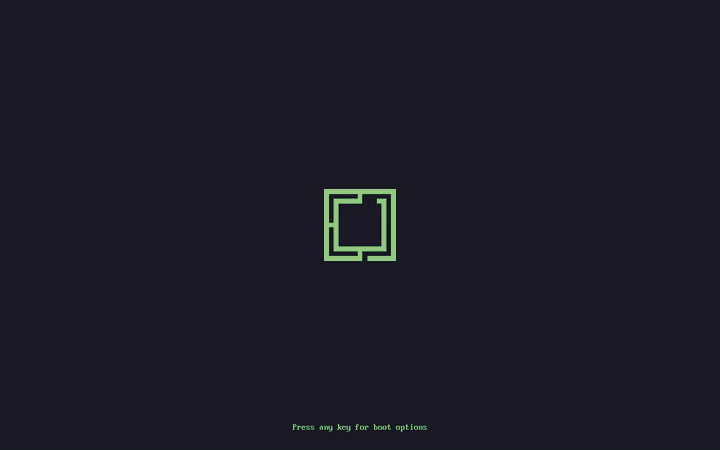
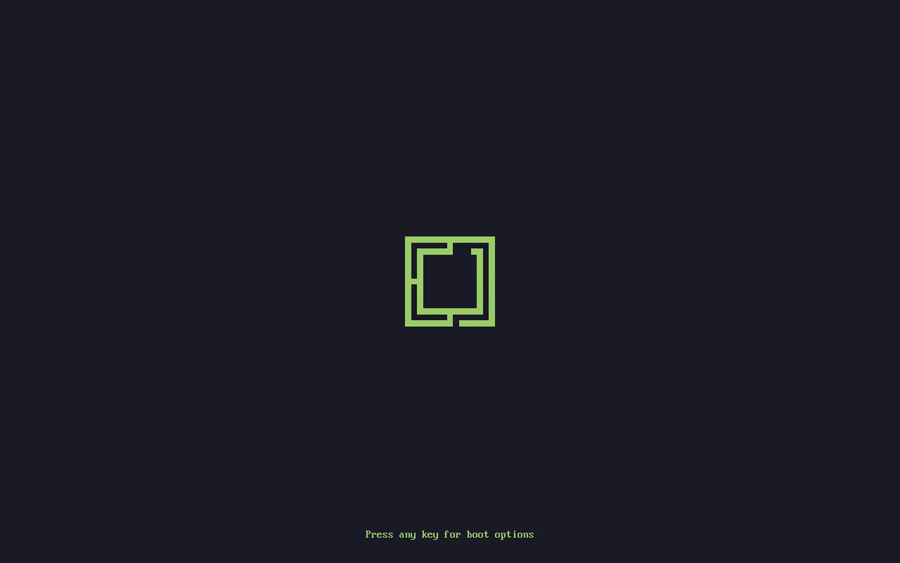
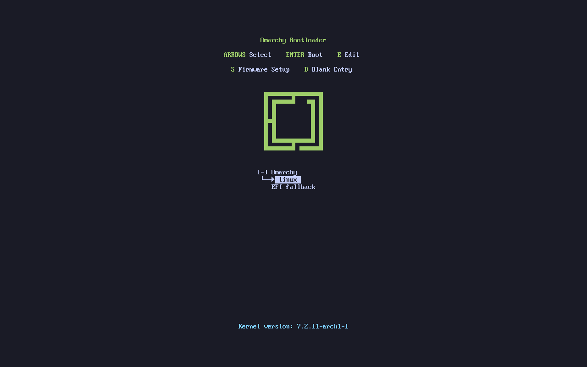
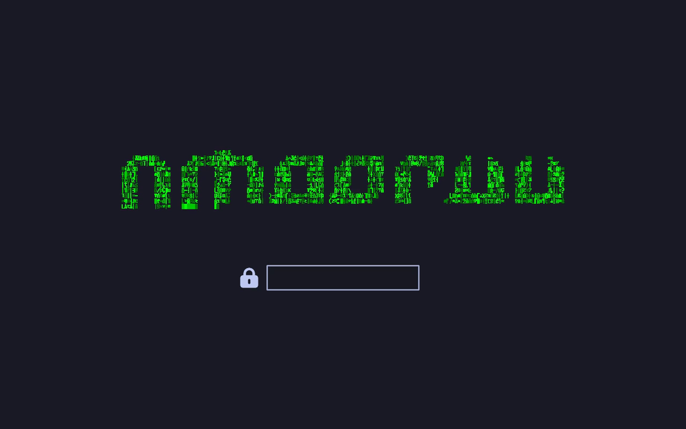
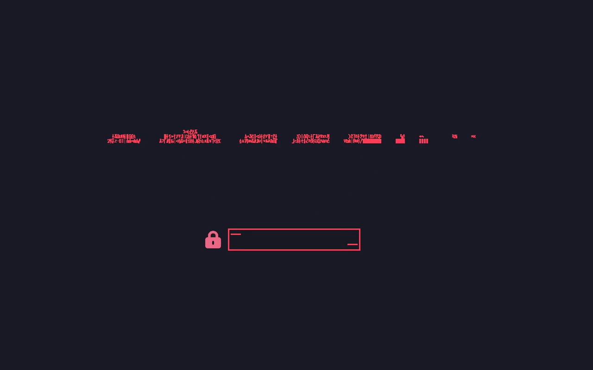
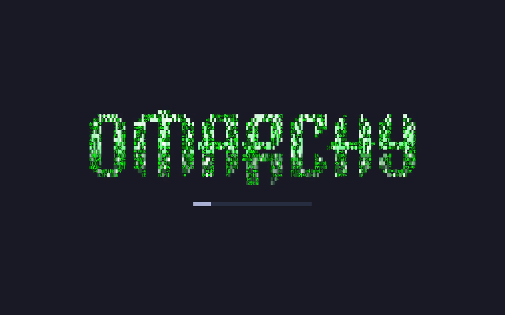
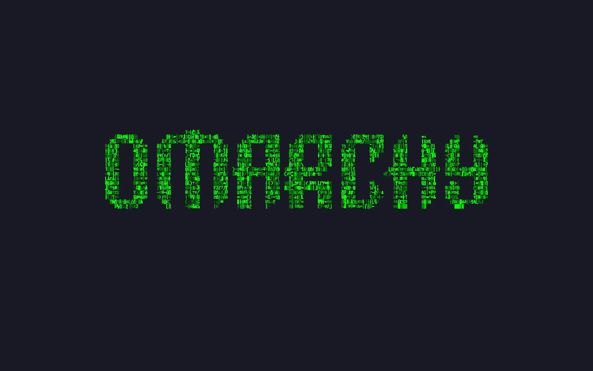

# Omarchy TTFX Bootloader

Native TTFX animation for Omarchy's Plymouth boot and LUKS unlock screen, for Omarchy 4.5 on x86_64 and aarch64.

The boot integration targets Omarchy quattro (base `6194f4606`) with the
TTFX 0.5.1 engine.



[Full boot video](https://github.com/avillagran/omarchy-ttfx-bootloader/releases/download/plymouth-ttfx-26.134.222-r2/omarchy-ttfx-boot-qemu.mp4) (Omarchy 4.5 in QEMU, wrong password included).

| Limine during its timeout | Limine menu after a key press |
|---|---|
|  |  |
| **Unlock prompt (Decrypt)** | **Wrong password** |
|  |  |
| **Unlocked** | **Reverse outro into the desktop background** |
|  |  |

The two Limine screens need a Limine built with [`patches/limine-quiet-wallpaper.patch`](patches/limine-quiet-wallpaper.patch); a stock Limine shows nothing during the timeout and the themed menu after a key press.

## Install

```bash
curl -fsSL https://raw.githubusercontent.com/avillagran/omarchy-ttfx-bootloader/main/install.sh | bash
```

By default the installer uses a prebuilt module, so the machine needs no compiler. To compile the module on the machine instead:

```bash
curl -fsSL https://raw.githubusercontent.com/avillagran/omarchy-ttfx-bootloader/main/install.sh | bash -s -- --build
```

The installer downloads a pinned source archive and checks its sha256. It then:

- installs the few Arch packages it needs: `plymouth`, `pkgconf`, `python`, `file` and `binutils`. `--build` also needs `base-devel`, and Rust if neither root nor you have a working toolchain (`~/.cargo/bin`);
- by default, downloads the prebuilt module for the machine's architecture from the GitHub release named in `prebuilt/manifest`, and checks it against the sha256 pinned there. `--build` compiles it instead from vendored TTFX 0.5.1;
- activates the `omarchy` theme;
- rebuilds the UKI or initramfs and checks that the new image carries the module.
- themes the bootloader (Limine or GRUB) with the same Omarchy mark Plymouth shows, so the picture stays put from the bootloader to the unlock screen.

When the splash ends, the logo animation plays backwards until only the background is left, the colour the desktop starts on, so there is no black blink between Plymouth and Hyprland. On Apple Silicon a static mark covers the seconds before the native display driver takes over, placed where m1n1 draws its logo.

Omarchy boots Limine with `quiet: yes`, which draws nothing during its one-second timeout. The installer adds `quiet_wallpaper` to `/boot/limine.conf`; a Limine built with [`patches/limine-quiet-wallpaper.patch`](patches/limine-quiet-wallpaper.patch) then shows the mark and "Press any key for boot options" during the timeout, and raises the mark above the entries when the menu opens. A stock Limine ignores the key. The patched package is proposed to Omarchy in omacom/omarchy-pkgs.

The prebuilt modules target exactly the Plymouth ABI the build supports (`26.134.222`, the same on Arch x86_64 and Arch Linux ARM). On any other Plymouth version the default mode stops before changing anything and asks for `--build`.

The native installer verifies only the boot images it rebuilds: owned Omarchy UKIs or the images named by mkinitcpio presets. Other distributions and hand-saved images are left untouched.

It also adds these entries under `Menu → Appearance → Bootloader`:

- `Input Only`: the default. Plays once, speeds up when the password is submitted, and holds the final frame until the desktop appears.
- `Full Animated`: loops continuously from boot until the desktop appears.
- `Effect`: picks any supported TTFX effect and keeps it. `Decrypt` is the initial and fallback effect; `Off` is not offered.

The animation runs at 2×. Your effect and playback choices survive reinstalls and theme branding changes. The installer includes the quattro branding helper and backs up the command it replaces.

The menu entries go into your `~/.config/omarchy/extensions/omarchy-menu.jsonc` as a block between `// omarchy-ttfx-bootloader:start` and `:end` markers. The installer edits the file as your user, only inside those markers, and changes nothing if the result would not parse.

The runtime helpers are installed in `/usr/share/omarchy/bin`, `/usr/local/bin` and `/usr/bin`.

At the end of boot, Plymouth gives up the display before it quits, and leaves its last frame on screen until the desktop draws over it. The renderer of the `omarchy-audio-background` plugin is its own and is not touched.

An `omarchy-settings` update may put the stock Plymouth theme back. Run the installer again afterwards. A failed install or reinstall restores its pre-attempt snapshot; publication is serialized with effect and branding commands through the shared Plymouth lock. Pre-attempt snapshots are retained under `/var/tmp` for inspection.

Reboot after installation to check the full boot path.

## Uninstall

```bash
curl -fsSL https://raw.githubusercontent.com/avillagran/omarchy-ttfx-bootloader/main/uninstall.sh | bash
```

Uninstall restores the original of each file only if the file is still exactly what the install wrote. A file that changed since then stays as it is and is listed at the end, for example one that an `omarchy-settings` update replaced.

It also:

- removes the menu block;
- restores the previous Plymouth theme;
- rebuilds the boot images.

An install made by the 2026-09 installer must be upgraded by running the current installer once before it can be uninstalled.

## Prebuilt modules

`scripts/build-prebuilt.sh` builds both release modules from a clean commit inside rootless Arch containers. aarch64 runs under qemu-user, so the host needs `qemu-user-static` binfmt. The script prints each module's sha256 and records the toolchain versions in `build-info.txt`. Publish the modules as assets of a GitHub release, write that release URL and the sha256 values into `prebuilt/manifest`, and re-pin the one-liner to the commit that carries the manifest.

## Local verification

```bash
bash tests/verify.sh
```

Run this on the target architecture with Rust (including Clippy), GCC, Python 3,
Node.js, strace, and the matching Plymouth development libraries installed.
The checks include an isolated offline build, C ABI isolation tracing, sanitized
plugin tests, and a real module build staged into a temporary directory. They
run without root and leave fixtures under `${TMPDIR:-/var/tmp}` for inspection.
They do not activate the staged theme or rebuild the machine's boot images.

TTFX 0.4.0 introduced an assembly engine; upstream removed it in 0.5.0. This
integration pins 0.5.1. Plymouth uses the original engine's structured cell API;
upstream's optimized `fx` terminal runner is not used by the boot animation.
See [the upstream releases](https://github.com/omacom/ttfx/releases) and
[the integration details](native/plymouth-ttfx-engine/UPSTREAM.md).


`native/` and the runtime helpers in `bin/` come from the Omarchy branch `feature/ttfx-plymouth-quattro`. `native/plymouth-ttfx-engine/UPSTREAM.md` records the TTFX import and its downstream patch.
